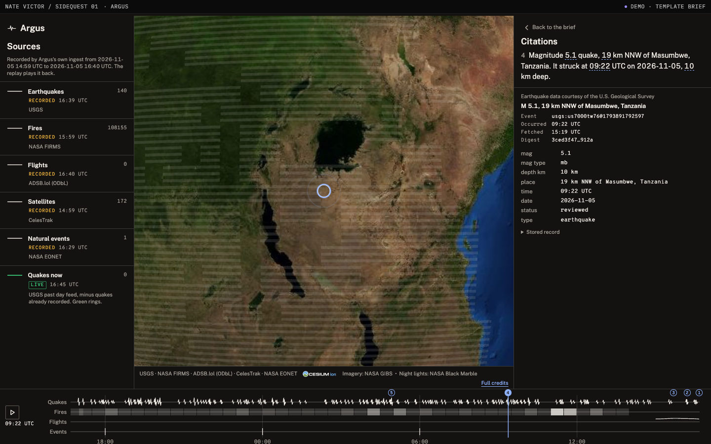
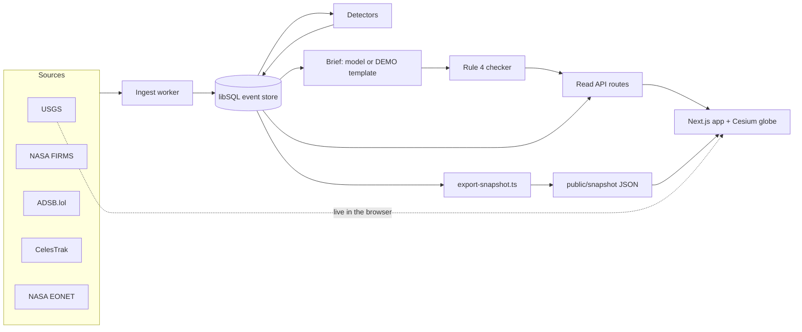

# Argus

Live demo: https://argus-seven-eta.vercel.app

A real-time view of Earth plus an analyst whose every sentence links to the raw events behind it.



## Why it exists

Open-source OSINT dashboards put data on a map. Argus also explains the data, and you can check every sentence against its source. Code computes every number. A sentence that cites no stored event does not ship.

Click a sentence in the brief. The globe flies to the events it cites, rings them, and the side panel opens each stored record with the facts the sentence copied.

## Features

- 5 layers, each with a toggle and its source credit on screen: USGS earthquakes, NASA FIRMS heat detections, ADSB.lol flights, CelesTrak satellites (SGP4 with satellite.js), NASA EONET natural events.
- A replay strip that plays back the last day of stored events.
- 3 deterministic detectors with every threshold in `argus.config.ts`: earthquake clusters, circling aircraft, heat detection growth.
- The brief: 5 sentences, each citing the stored event ids it uses. `src/check/check-brief.ts` rejects any sentence with a number that is not in a fact of an event it cites.
- Ask Argus: answers come only from tools that query the event store. A count is saved as its own citable event.
- Privacy by construction: aircraft are stored without callsign, registration, or address, and no tool, route, or parameter looks an aircraft up.

## Two ways it runs

| Mode                     | Data                                                                                        | Brief and Ask                                                                                                        |
| ------------------------ | ------------------------------------------------------------------------------------------- | -------------------------------------------------------------------------------------------------------------------- |
| Store (local)            | The ingest worker polls every source into a libSQL file.                                    | The model writes the brief from detector output; numbers are checked before it is served. Needs `ANTHROPIC_API_KEY`. |
| Snapshot (static deploy) | Recorded JSON exported from the store, plus the USGS past day feed fetched by your browser. | DEMO: code fills fixed sentences from stored facts. The same checker passes them. No model runs.                     |

The snapshot deploy says which is which. The strip at the top reads DEMO, LIVE, or RECORDED, and each source row carries its own tag. Vercel cannot run the ingest worker or keep a database file, so the deploy plays back a recording instead of pretending to be live.

## Architecture



The globe lives in its own package, `packages/globe`, with no Argus imports. Cesium runs tokenless: no ion services, no Bing imagery.

## How to run

Requirements: Node 22.18 or newer and pnpm 10.

```sh
pnpm install
pnpm ingest --loop             # poll every source into data/argus.db (Ctrl+C stops it)
pnpm dev                       # http://localhost:3000, reads the store
```

The live brief needs `ANTHROPIC_API_KEY` and the scheduler secret in `.env.local`. `.env.example` lists the names.

Static deploy, from a recorded store:

```sh
DATABASE_URL=file:./data/argus.db node scripts/export-snapshot.ts   # writes public/snapshot
ARGUS_MODE=snapshot pnpm build && pnpm start
```

A Vercel build sets snapshot mode on its own. The export writes the DEMO brief, checks it, and exits 1 if any number fails.

Checks:

```sh
pnpm lint && pnpm format && pnpm typecheck && pnpm test
pnpm check:copy && pnpm check:indexes
node scripts/check-briefs.ts --db file:./data/argus.db
PW_E2E=1 pnpm test:e2e         # needs a snapshot build
```

## Data sources and terms

Each source's terms, the credit shown on screen, and every committed data file are in [DATA-LICENSES.md](DATA-LICENSES.md). In short: USGS data is U.S. public domain. FIRMS is openly shared. ADSB.lol data is under the ODbL. CelesTrak elements are redistributed with citation. EONET is for general information only.

## Known limits

- The static deploy replays a recording. Flights exist only from the first fetch of the recording; earlier hours of the replay show none.
- The DEMO brief is a template, not a model. It leads with a count of quakes at magnitude 4.5 or more, then the facts pack in its usual order.
- Flights cover 3 regional areas (London, New York, Los Angeles), not the whole Earth.
- Fire growth needs 2 complete solar days of FIRMS files, so a fresh recording has no growth findings.
- Best on a desktop browser with WebGL. Without WebGL the brief and citations still work and the globe area says why it is empty.

## Affiliation

A personal project by Nate Victor. Not affiliated with USGS, NASA, ADSB.lol, or CelesTrak.

## License

MIT for the code (see [LICENSE](LICENSE)). Data keeps its own terms (see [DATA-LICENSES.md](DATA-LICENSES.md)).
